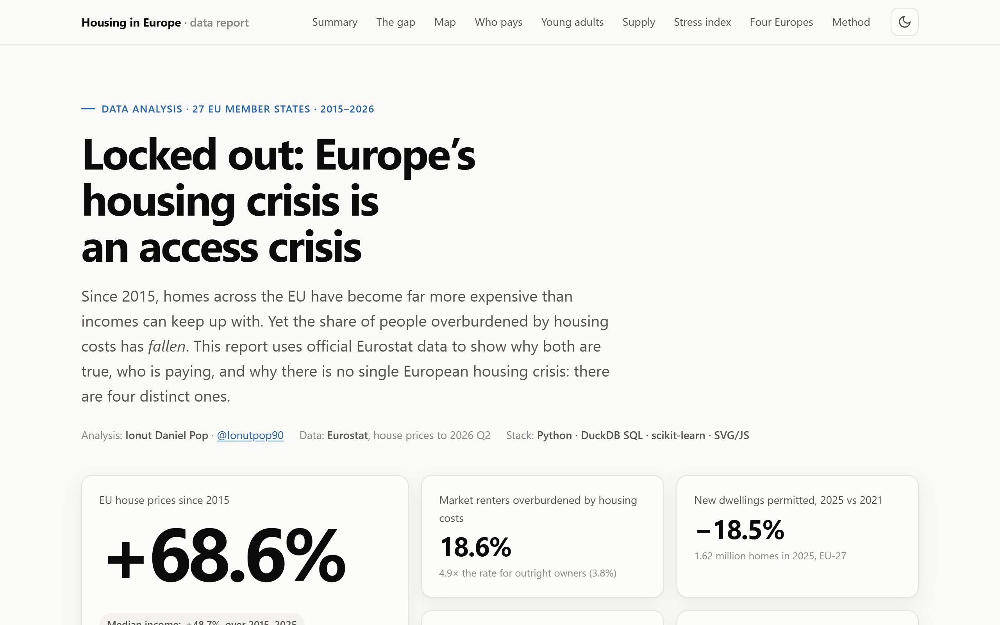
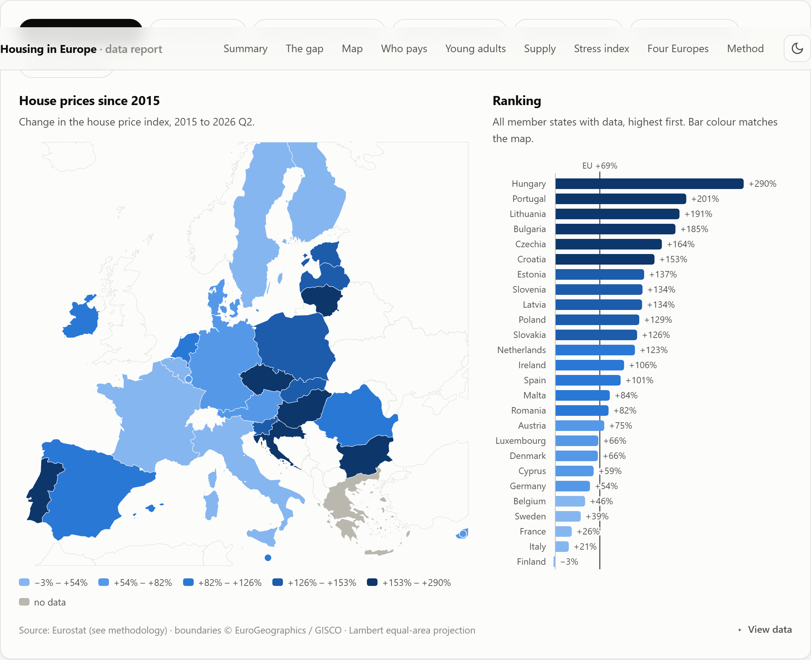
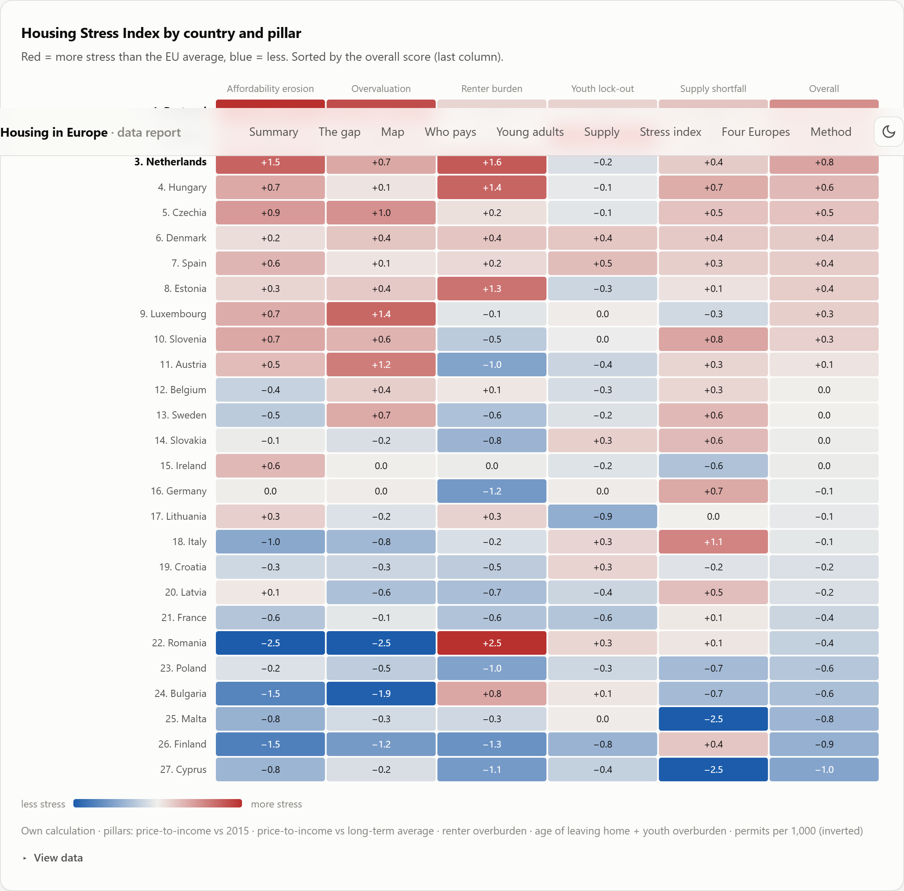
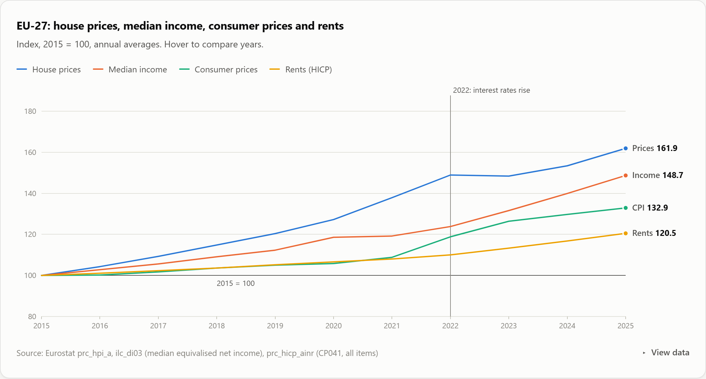
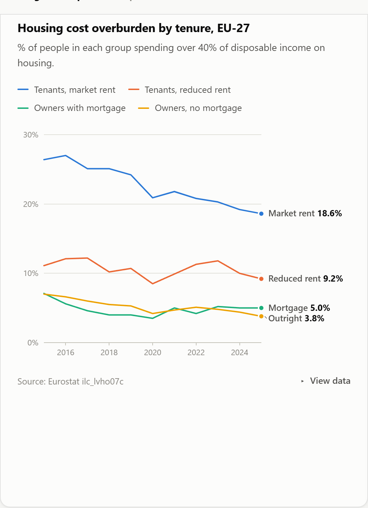
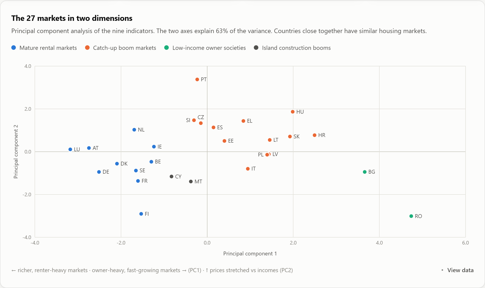
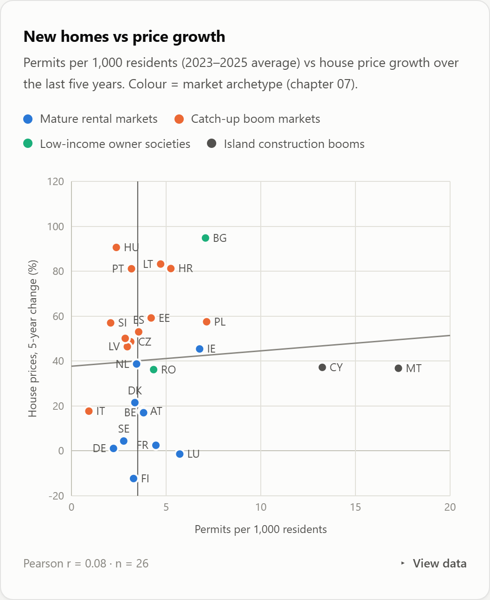

# Locked out: Europe's housing crisis is an access crisis

**An end-to-end analysis of housing affordability across the 27 EU member states, 2015–2026.**
It covers prices vs. incomes, who carries the burden, young adults, supply, a composite Housing Stress Index and a machine-learning segmentation of national housing markets.

**[▶ Live interactive report](https://europe-housing-affordability.vercel.app)** · Data: Eurostat (12 datasets) + GISCO · Stack: Python · DuckDB SQL · scikit-learn · vanilla JS/SVG



---

## Why this topic

Housing is the EU's most pressing social and economic question of 2026. The Commission published the first-ever **European Affordable Housing Plan** in December 2025, and the European Parliament adopted a motion on the housing crisis in March 2026. The cost of living is Europeans' number-one concern, and housing is the largest item in household budgets. Yet public debate often treats "the housing crisis" as one thing. This project tests that assumption with data.

## Questions

1. **The gap:** Have housing costs outpaced incomes, and by how much?
2. **Who pays:** Which groups and countries carry the burden?
3. **Young adults:** Are young people being locked out of independent living?
4. **Supply:** Is Europe building enough, and does supply explain prices?
5. **Synthesis:** Which countries are under most pressure, and are there distinct *types* of housing market?

## Key findings

| # | Finding | Evidence |
|---|---|---|
| 1 | **Prices outran incomes, and rents did not.** EU house prices are up **+68.6%** since 2015 (to Q2 2026). Median income is up **+48.7%** (to 2025). Measured rents rose only **+20.5%**, less than consumer prices (+32.9%). | Real (inflation-adjusted) house prices are +21.9%. The squeeze is on *buying* a home. |
| 2 | **It is an insiders-vs-outsiders crisis.** The overall housing-cost overburden rate *fell* from 11.2% to 7.7%. Market renters, however, are **4.9×** as likely to be overburdened as outright owners (18.6% vs 3.8%). | Two in three Europeans own their home, which masks the stress on those who don't. |
| 3 | **Young adults are stuck where rental markets are thin.** The average age of leaving home is **26.3**, ranging from 21.3 (Finland) to 31.5 (Croatia). It correlates with a small rental sector (r = −0.37) and with recent price growth (r = 0.44), but **not** with the price-to-income ratio (r = 0.06). | The barrier is getting a first foothold, not average affordability. |
| 4 | **Supply is falling, but it is not the whole story.** Residential permits are down **18.5%** since 2021 (1.62 million dwellings in 2025). Across countries, permits per capita barely correlate with price growth (r = 0.08). | Supply responds to prices as much as it drives them. Simple "just build more" narratives oversimplify. |
| 5 | **There are four housing crises, not one.** k-means on 9 standardised indicators finds 4 archetypes (best silhouette, k = 4). Ward hierarchical clustering reproduces the grouping exactly (ARI = 1.00). | The archetypes are mature rental markets, catch-up boom markets, low-income owner societies and island construction booms. |
| 6 | **Portugal, Greece and the Netherlands** top the Housing Stress Index. The ranking is robust: dropping any of the five pillars keeps Spearman ρ ≥ 0.89. | |

## Visuals

| Interactive map explorer (7 indicators) | Housing Stress Index |
|---|---|
|  |  |
| **Prices vs. incomes vs. rents** | **Burden by tenure** |
|  |  |
| **Four Europes: segmentation (PCA view)** | **Supply vs. prices** |
|  |  |

The report has an interactive choropleth with 7 switchable indicators, a synced ranking and crosshair and nearest-point tooltips. It supports keyboard navigation and has a data table behind every chart. It works in light and dark mode and on mobile. Colour palettes were validated for colour-vision deficiency. Where four categories exceed what can be told apart reliably, the fourth uses a neutral colour plus direct labels.

## Pipeline

```
Eurostat API ─┐                       ┌─ sql/01_staging.sql  (typed views, currency-break guard)
GISCO shapes ─┴─► data/raw ─► DuckDB ─┤
                                      └─ sql/02_marts.sql    (one model per question + QA coverage)
                                                 │
                       src/build_dataset.py ◄────┘
                       ├─ Housing Stress Index (z-scores, winsorised, LOO sensitivity)
                       ├─ k-means + silhouette, Ward cross-check, PCA
                       └─► report/data.json ─► interactive report (report/)
   src/build_map.py ─► report/map.json (LAEA equal-area projection, clipped & simplified)
```

| Layer | Highlights |
|---|---|
| **Extract** · [src/fetch_data.py](src/fetch_data.py) | Generic JSON-stat 2.0 parser and 12 Eurostat datasets. The fetch switched to annual permits after finding that quarterly country data is confidential. |
| **Model** · [sql/](sql/) | DuckDB views. `arg_max` takes the latest value per country, `FILTER` pivots reshape the data, and a `UNPIVOT` coverage report checks completeness. A currency-break guard handles Croatia's 2023 kuna to euro switch (otherwise it shows as a false −64% in income). |
| **Analyse** · [src/build_dataset.py](src/build_dataset.py) | 5-pillar composite index with equal weights and z-scores winsorised at ±2.5. Leave-one-pillar-out Spearman sensitivity. k-means (k = 2…6, silhouette), validated by Ward (ARI) and summarised with PCA. |
| **Map** · [src/build_map.py](src/build_map.py) | GISCO boundaries projected to Lambert azimuthal equal-area (EPSG:3035 parameters), clipped to Europe and simplified to 67 kB. |
| **Report** · [report/](report/) | Dependency-free SVG chart kit with choropleth, scatter, heatmap, line, bar and column charts. Every number in the text is bound to the data. |

## Reproduce

```bash
pip install -r requirements.txt
python src/fetch_data.py         # download Eurostat + GISCO data
python src/build_map.py          # build the projected basemap
python src/build_dataset.py      # SQL models, index, clustering -> report/data.json
python -m http.server -d report  # open http://localhost:8000
```

## Limitations

- Indicators have different latest years: house prices run to 2026 Q2, EU-SILC survey data to 2025, and the price-to-income ratio to 2024.
- The HICP rent index tracks all existing tenancies and under-represents new contracts in cities.
- Greece is not covered by Eurostat's house price index. It shows as n/a on price maps and is median-imputed only in the clustering.
- n = 27: the clusters describe structure; they are not statistical proof. Index weights are a choice, and the sensitivity test shows they do not drive the ranking.
- The analysis is descriptive and shows correlation, not causation.

## Data sources

Eurostat (© European Union, reuse authorised with acknowledgement): `prc_hpi_q`, `prc_hpi_a`, `tipsho60`, `ilc_di03`, `prc_hicp_ainr`, `ilc_lvho07a`, `ilc_lvho07c`, `ilc_lvho05a`, `ilc_lvho02`, `yth_demo_030`, `sts_cobp_a`, `demo_gind`. Country boundaries: GISCO, © EuroGeographics.

---

*Author: **Ionut Daniel Pop** · GitHub [@Ionutpop90](https://github.com/Ionutpop90) · Other projects: [Romania by the numbers](https://github.com/Ionutpop90/romania-by-the-numbers) · [Europe car transition](https://github.com/Ionutpop90/europe-car-transition) · [Europe health check](https://github.com/Ionutpop90/europe-health-check) · [Romania vs EU inflation](https://github.com/Ionutpop90/romania-inflation-analysis)*
